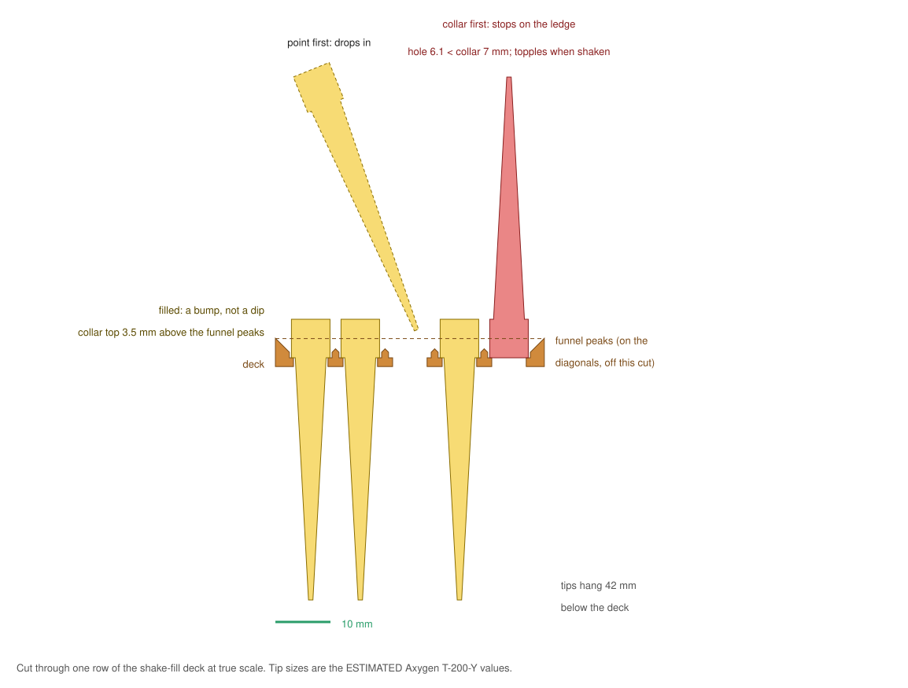

# benchscale

**Describe a piece of lab apparatus in plain words; get a printable part sized against the real objects it
holds.**

Small custom bench parts cost a lab real money. A tilted dock for a tip box, a rack for an odd tube, or a
loader for bulk tips gets sold as a "custom" catalogue item, or someone spends an afternoon in CAD. A
3D printer makes them for cents, but only if the part fits first time. benchscale makes real scale the core
of the design:

- **A reference library of real objects.** It holds 163 labware definitions from Opentrons (tip racks,
  plates, reservoirs, tube racks), cited standards (the 96-well footprint, Falcon tubes, test tubes, slides,
  pipette tips), and anything you measure yourself. Every size carries its source and a confidence label.
- **Parametric templates built around those objects.** The object is placed in the design as a "ghost"
  and checked for collisions, so a pocket that is too small fails a check instead of a print.
- **Checks you can trust.** Each one is labelled *computed from the model* or *ESTIMATED*, and the two are
  never mixed.
- **Three ways in:** an MCP server (Claude Desktop, Claude Code), a command line, and a local 3D viewer
  with an optional chat.

## 3D Print for Science

**Scientists and students in Singapore: describe a bench part you need, and we design it for free.**

[**Submit a request**](https://github.com/zhenwei2972/benchscale/issues/new?template=print-request.yml) ·
[open queue](https://github.com/zhenwei2972/benchscale/issues?q=is%3Aissue+is%3Aopen+label%3Aprint-request)

- **The designs are AI-generated.** Claude builds them with benchscale, and they are research and
  development quality. The more detail you give, the better the part.
- **Printing is best effort.** There is one Bambu Lab A1 mini, printing PLA up to about 175 mm a side, in
  queue order. No turnaround is promised.
- **Designs are free and open.** Every design is published here for anyone to print.
- **Not for:** sterile or autoclaved use, use on people, or anything hazardous.

**Good requests name the real objects, give sizes, and say what goes wrong today.** For example:

> Dock for an Axygen T-200-Y 200 µL tip box (standard 128 x 86 mm footprint), tilted 15° towards me, so it
> stops sliding in the biosafety cabinet. The top of the box must stay under 120 mm.

> Rack for 8 Falcon 50 mL tubes in two rows that fits our 90 mm-wide fridge shelf. The tubes must stand,
> not lean.

> Holder for a 25 x 75 mm microscope slide at 30° for photographing under a phone camera, with a
> 10 mm ledge so the slide cannot slip.

The form is public, so do not include personal details or anything confidential.

## Quick start

benchscale needs **Python 3.10 or newer**. The `python3` that ships with macOS is 3.9 and will not
work. Use [uv](https://docs.astral.sh/uv/) or a Homebrew Python:

```bash
git clone https://github.com/zhenwei2972/benchscale && cd benchscale
uv venv --python 3.12 && uv pip install -e ".[dev]"     # or: python3.12 -m venv .venv && .venv/bin/pip install -e ".[dev]"
.venv/bin/benchscale templates
```

Design something and look at it:

```bash
.venv/bin/benchscale design shake_fill_rack -p rows=3 -p cols=4 -p hole_step=0.3
.venv/bin/benchscale serve            # http://localhost:8742 shows the latest design at true scale
```

### Use it from Claude

Add the MCP server to Claude Code:

```bash
claude mcp add benchscale -- /path/to/benchscale/.venv/bin/benchscale mcp
```

For Claude Desktop, add this to `claude_desktop_config.json`:

```json
{"mcpServers": {"benchscale": {"command": "/path/to/benchscale/.venv/bin/benchscale", "args": ["mcp"]}}}
```

Then just ask, for example: *"Our bulk Axygen 200 µL tips take ages to rack. Make me something that
loads them."* Claude searches the references, picks a template, builds the part, and reports every check
with its label. Keep `benchscale serve` running and the viewer refreshes on each new design.

The built-in chat at `localhost:8742` is optional and needs `pip install -e ".[chat]"` plus an Anthropic
API key in the environment.

## Templates

| Template | What it makes |
|---|---|
| `shake_fill_rack` | A 96-position tip rack that loads itself from loose bulk tips (below) |
| `tip_box_dock` | Holds a tip box tilted toward you, gripped so it cannot slide, with finger notches and recesses for rubber feet |
| `tube_rack` | A rack for any tube in the library or one you measured; prints upside down without support |
| `holder` | A block with a pocket shaped to one object: a plate, slide, bottle or tube |

`benchscale template <name>` lists each template's parameters with units and limits.

## Featured: a tip rack that fills itself from bulk tips

Bulk tips cost about half as much as racked ones. Racking them by hand is slow, and the printable
loaders people share need a hand-fixing pass afterwards. Two failures cause that: a tip goes in upside
down, or a tip drops into a filled position and stacks inside the tip already there.

`shake_fill_rack` is designed so neither can happen:



- **Each hole is narrower than the tip's collar.** A tip can only enter point first and then hangs by
  its collar. Collar first, it stops on the ledge and topples off when shaken.
- **A filled position stands 3.5 mm proud of the funnel peaks.** That makes a full hole a bump and an
  empty hole a dip. Loose tips slide off the full holes and into the empty ones, instead of being funnelled
  into a seated tip's open top.
- **The funnels overlap like an egg crate.** The model has 0.0% flat land on the deck top (computed), so a
  tip has nowhere to lie still.
- **It is three parts, each printed flat without support:** the deck, a stand that holds it at the height
  the tips hang, and a lid you hold on while shaking.

**How-to video:** [docs/shake_fill_howto.mp4](docs/shake_fill_howto.mp4) (53 s, a keyframed true-scale animation of the parts, rebuilt with `tools/export_video_assets.py` and `blender -b -P tools/howto_video.py`).

To load it, pour on about 1.5 times as many tips as there are holes and put the lid on. Shake side to side
for 10 to 20 seconds, then lift the lid. Tilt the rack, without turning it over, to pour the extra tips back.

**Fit your tips before printing the full rack.** Corning publishes no dimensioned drawing of the Axygen
T-200-Y, so the tip sizes in the library are ESTIMATED (collar 7.0 mm, body 5.6 mm, 51 mm long). The coupon
settles it with your own tips on your own printer:

```bash
benchscale design shake_fill_rack -p piece=deck -p rows=3 -p cols=4 -p hole_step=0.3
```

This makes a 12-hole deck with hole sizes of 5.65, 5.95, 6.25 and 6.55 mm, one size per column. Column 1
is next to the cut corner. The right column holds a tip upright with its collar down in the pocket. Then
build the full rack with that size, using `-p hole=<mm>`, or pass your caliper readings with
`-p collar_od=` and `-p body_od=`.

These are the slicer's figures (ESTIMATED; Bambu Studio, A1 mini, 0.2 mm layers, 15% infill):

| Print | Time | PLA |
|---|---|---|
| Coupon deck, 12 holes | 19 min | 3.4 g |
| Coupon set, deck + stand + lid | 1 h 12 min | 32.9 g |
| Full rack: deck | 1 h 21 min | 19.9 g |
| Full rack: stand | 1 h 24 min | 48.7 g |
| Full rack: lid | 1 h 05 min | 43.0 g |

The price difference comes from Corning eCatalog list prices (Middle East region, 11 Oct 2026). Bulk
T-200-Y costs $668.13 per 20,000 tips, about $0.033 each. Racked T-200-Y-R costs $324.75 per 4,800, about
$0.068 each. Racking bulk tips saves about $3.30 per 96 tips. The full rack uses 112 g of PLA (slicer
ESTIMATE), about $2 at $20 per kg.

How well it fills (the share of holes filled, and in how many seconds) has **not been measured yet**. The
coupon print is that test.

Note that PLA is not autoclavable; it softens near 60 °C. Use the rack for non-sterile tips such as T-200-Y.

**Prior art, credited and not copied:**
- [ETH Zurich iGEM 2016 tip stacker](https://2016.igem.org/Team:ETH_Zurich/Hardware): shake tips into a
  printed rack, then transfer them with a comb.
- [Vapecream's modular tip sorting box](https://www.printables.com/model/896781-modular-pippette-tip-sorting-box),
  and its parametric remix [11mbs/pipette-tip-sorter](https://github.com/11mbs/pipette-tip-sorter). The
  remix's notes about tips squeezing into the same slot and holes left empty shaped the failure analysis
  above.

## Demo: a tilted dock for a tip box

The request: *"We keep a TipOne 200 µL rack at the back of the biosafety cabinet and lean over it all
day; it slides when I load the 8-channel. Make me a dock that tilts it toward me about 15 degrees, grips it
so it can't slide, lets me lift it out with two fingers, and keeps the top of the box under 120 mm so it
clears the sash."*

`python examples/demo_mcp_client.py` makes the same tool calls Claude makes over MCP: search_references,
get_reference, describe_template and design_part. The result:

- **Size:** 134.8 × 97.7 × 38.9 mm, one closed solid, fits the A1 mini (computed).
- **Fit:** the rack sits in a 128.76 × 86.48 mm pocket, built from the TipOne definition's 127.76 × 85.48 mm
  base. The rack does not touch the walls (overlap 0.000 mm³, computed).
- **Slicer estimate (ESTIMATED):** 2 h 31 min and 72.9 g of PLA. Whether the box stays put at the 15°
  tilt is also ESTIMATED.

## Free base models

`benchscale bases` lists 17 OpenSCAD designs from
[prompt-to-bench](https://github.com/ATinyGreenCell/prompt-to-bench), licensed CERN-OHL-P-2.0. They are
vendored with their licence. Rendering them needs [OpenSCAD](https://openscad.org) on the PATH; listing
them does not.

## Where the numbers come from

| Source | Licence | Confidence |
|---|---|---|
| Your measurements (`benchscale measure`) | yours | measured; these win over everything else |
| `data/standards.json`, cited per entry | facts | standard / manufacturer nominal / ESTIMATED |
| [Opentrons labware library](https://github.com/Opentrons/opentrons/tree/edge/shared-data/labware), 163 definitions | Apache-2.0 | manufacturer-derived definitions |

Third-party notices are in [NOTICE](NOTICE).

## Licence

MIT for benchscale's own code. Bundled third-party data keeps its own licence (see NOTICE).
