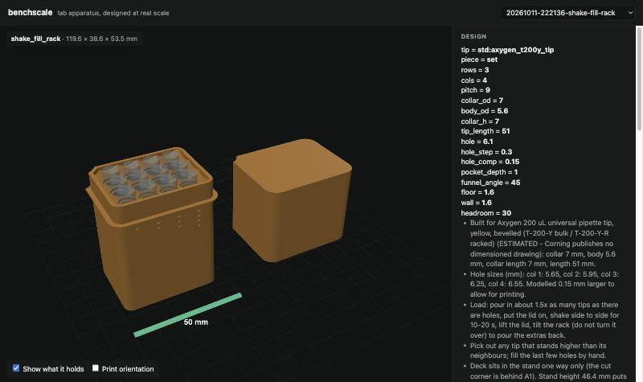
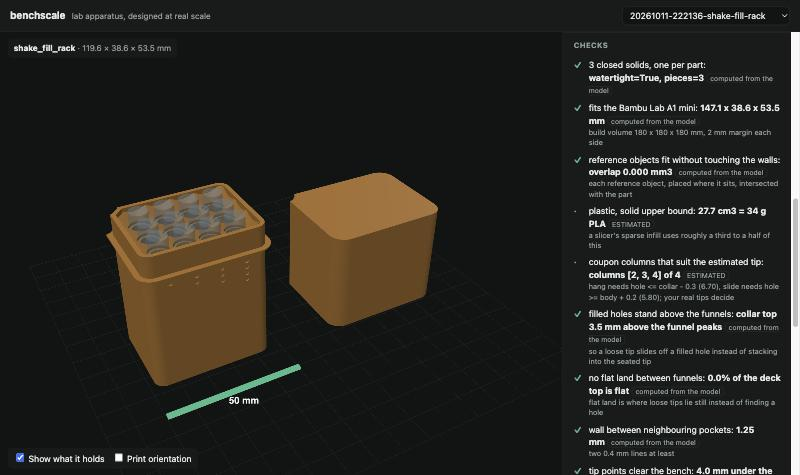
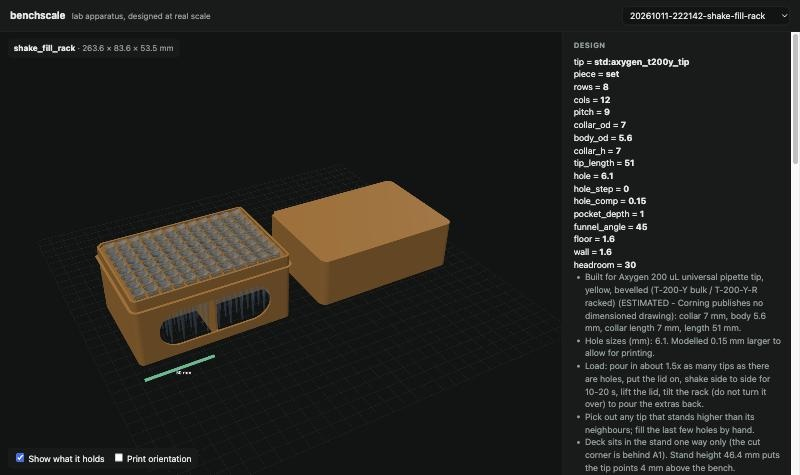
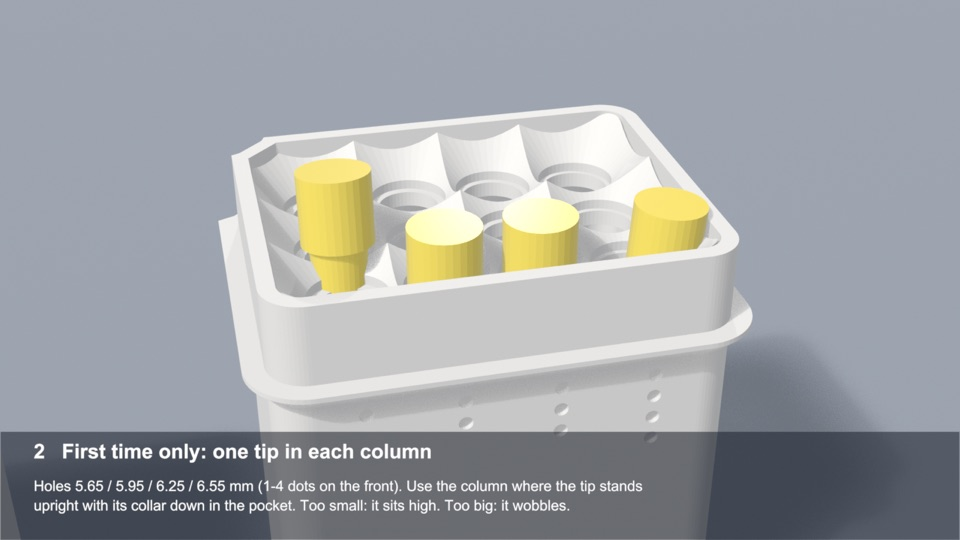
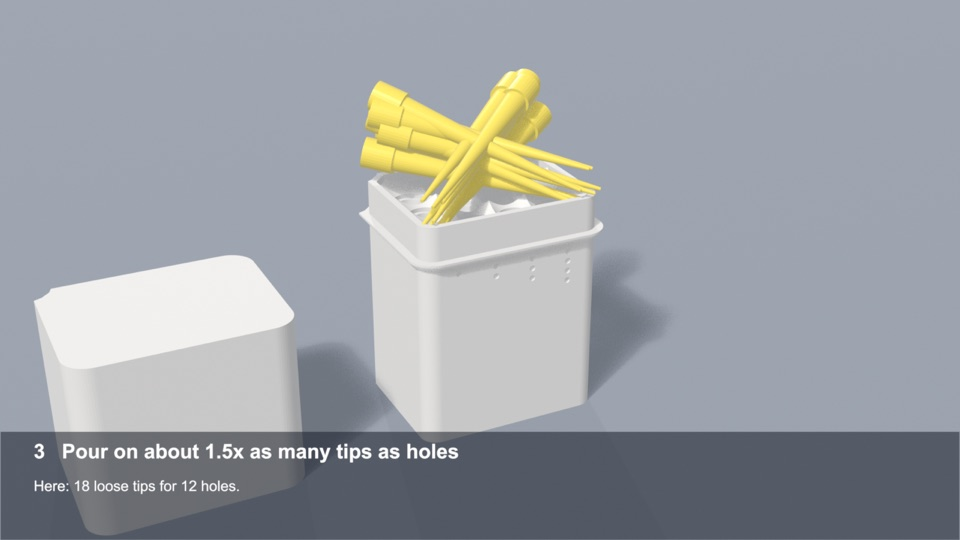
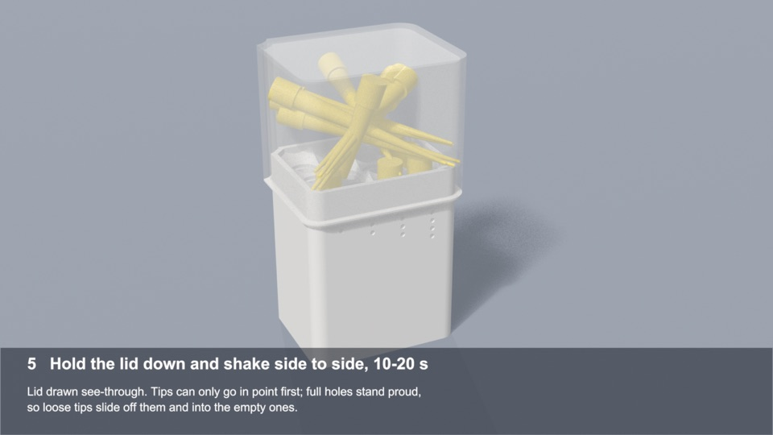
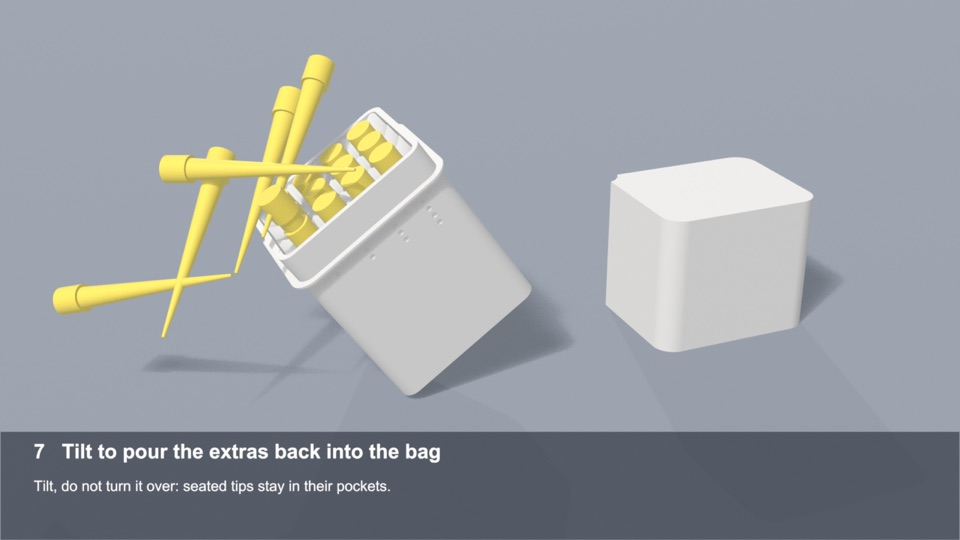
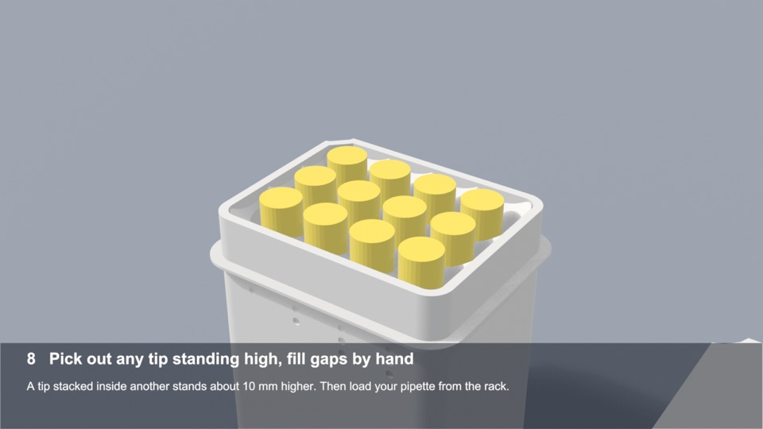

# Walkthrough: a pipette tip sorter, from request to print

This is a real example, start to finish. It shows the words that were typed, what Claude did with them,
what the design looked like, the safety checks before printing, and the report afterwards. Everything here
happened on 11–12 October 2026 with Claude, benchscale and a Bambu Lab A1 mini.

**In short:** one sentence became a three-part tip rack that loads itself from bulk tips. A 12-hole test
version printed successfully on the first try, in 68 minutes against a 72-minute estimate.

---

## 1. The request

> **"how about a pipette tip sorter that really works for 200 micro liter axygen tips"**

That was the whole prompt. Claude then worked through four steps.

**It looked for what already exists, and why those designs fall short.** Free designs (an
[ETH Zurich iGEM tip stacker](https://2016.igem.org/Team:ETH_Zurich/Hardware) and
[Vapecream's sorting box](https://www.printables.com/model/896781-modular-pippette-tip-sorting-box) with its
[parametric remix](https://github.com/11mbs/pipette-tip-sorter)) drop tips through funnels or slots into a
box. Their own notes say you still fix tips by hand: some land upside down, and some drop into a filled
spot and stack inside the tip already there.

**It looked up the tips.** Corning publishes no drawing of the Axygen T-200-Y, so the sizes (collar
7.0 mm, body 5.6 mm, 51 mm long) are **estimates**, and are labelled that way everywhere.

**It checked the cost.** Bulk T-200-Y tips cost about $0.033 each, against $0.068 racked (Corning list
prices). Racking bulk tips saves about $3.30 per box of 96.

**It chose a design that makes both failures impossible:**


- **Each hole is narrower than the tip's collar.** A tip can only go in point first, and it hangs by its
  collar. Upside down, it can't go in.
- **A filled hole stands 3.5 mm above the funnels.** That makes a full hole a bump and an empty hole a dip,
  so loose tips slide off full holes and into empty ones.

## 2. The design, in benchscale

Claude built the part with benchscale's `shake_fill_rack` template. Before printing all 96 holes, it made
a **12-hole test coupon**. Each of its four columns has a different hole size (5.65, 5.95, 6.25 and
6.55 mm), so your own tips can show which size fits best.

```text
benchscale design shake_fill_rack -p rows=3 -p cols=4 -p hole_step=0.3
```

In Claude this is the `design_part` tool, which Claude chose itself; you just ask in plain words.



*The test coupon at true size: the stand with the deck seated in it, the lid beside it, and the tips
(blue) where they will hang. The 1–4 dots on the front mark the columns.*

Every design comes with checks. Each is marked as either **computed** from the 3D model or **ESTIMATED**:



| Check | Result | Basis |
|---|---|---|
| Three closed parts that fit the A1 mini, all on one plate | ✓ 147 × 39 mm laid out | computed |
| Tips don't touch anything they shouldn't | ✓ overlap 0.000 mm³ | computed |
| Filled holes stand above the funnels | ✓ 3.5 mm | computed |
| No flat area where a tip could lie still | ✓ 0.0% flat | computed |
| Wall between neighbouring holes is printable | ✓ 1.25 mm | computed |
| Which columns should suit the estimated tip | columns 2, 3 and 4 | ESTIMATED |

The full 96-hole rack is the same design at full size. It prints as three parts, one at a time:



## 3. Printing, with a check before anything starts

Claude prepared the file with **Bambu Studio** (Bambu Lab's own slicer) and ran the safety checks. Then it
asked before printing, as it always does:

> **Claude:** *The A1 mini is idle with PLA loaded, the plate is clear, and the coupon's pre-print checks
> passed. What should I print?* Coupon deck (19 min) · **Coupon set (1 h 12 min, 32.9 g)** · Tip-box dock ·
> Nothing yet
>
> **You:** Coupon set

The pre-print record for this print:

| Check | Result | Evidence |
|---|---|---|
| File made for the A1 mini, textured plate, right bed temperature | PASS | model id N1, bed 65 °C for PLA |
| Everything stays on the 180 × 180 mm plate | PASS | X 70.9–109.1, Y 16.7–163.3 mm |
| First layer clear of the purge line at the front | PASS | |
| Printer idle, no alerts | PASS | |
| Loaded filament matches the file | PASS | PLA |
| Plate clear (from the printer camera) | PASS | |

Slicer estimate (ESTIMATED): 1 h 11 min 44 s, 32.9 g of PLA, 267 layers.

The printer tools check the file, the plate and the printer on every print. The plate-bounds and
purge-line rows above came from an extra checking script used for this run.

Only then did Claude start it (`upload_and_print(confirm=True)`) and begin watching it
(`watch_print`), taking a photo at each stage.

## 4. The report afterwards

After the print, Claude looked at each stage photo, wrote down what it could actually see, and put the
report together. Ask *"How did the print go?"* or run `mhs report 14 --markdown`. This is the generated
report, unedited (camera photos are left out because they show the room; each row says what was
visible):

### Print report: shake-fill coupon set

| | |
|---|---|
| Printer | a1mini |
| File | shake_fill_coupon_a1mini.gcode.3mf |
| Started | 2026-10-11T22:37:54+08:00 |
| Ended | 2026-10-11T23:46:15+08:00 (from the watcher's final frame) |
| Outcome | finished |
| Time | 68 min actual (MEASURED) vs 72 min slicer estimate (ESTIMATED): close to the slicer's estimate |

#### What the camera saw

| When | Stage | Layer | What is visible |
|---|---|---|---|
| 22:38:23 | start | 0 | Start: textured plate empty and clean; toolhead parked. |
| 22:46:45 | first_layer | 2 | Bed is forward, out of the camera's view: the first layer is not visible in this frame (it shows the base and safety sticker). |
| 23:11:08 | quarter | 67 | Plate seen edge-on from low; a low part visible at the back of the plate; no loose strands on the visible plate. Little detail at this angle. |
| 23:22:10 | half | 134 | Bed in motion (blurred); parts at the back not distinguishable; nothing loose on the visible plate. |
| 23:33:53 | three_quarters | 202 | All three parts standing and intact: stand on the left with the 1-4 column dots visible on its front face, the 12-hole deck in the middle (funnel row visible side-on), lid walls on the right. Straight walls, no spaghetti, nothing detached. |
| 23:46:15 | finished | 267 | Finished: dim frame with the bed forward; the deck with its grid of funnels and the upright stand are visible at lower left, nothing detached or stringy seen. Lid not clearly distinguishable in this light. |

_run 14: shake-fill coupon set, finished, 68 min, close to the slicer's estimate, 6 frame(s) captured_

## 5. Using it

A 53-second how-to video shows the steps on the real parts at true scale:
[shake_fill_howto.mp4](../shake_fill_howto.mp4). It is an animation (keyframed, not a physics simulation),
and the stills below come from it.

| | |
|---|---|
|  **First time only:** drop one tip into each column. Use the column where the tip stands upright, with its collar down in the pocket. |  **Pour** on about 1.5 times as many tips as there are holes. |
|  **Put the lid on and shake** side to side for 10–20 s. The lid is drawn see-through here. |  **Tilt** the rack to pour the extras back into the bag. Don't turn it over. |
|  **Check:** pick out any tip standing about 10 mm high (it is stacked inside another) and fill gaps by hand. | |

## What is proven, and what isn't yet

- **Proven:** the design passes every check computed from the model, and the test coupon printed
  successfully at about the estimated time (68 min against 72, MEASURED from the printer's own timestamps).
- **Not yet measured:** how well it actually fills with real Axygen tips (how many holes, and how fast),
  and which column fits them best. That's the next test. The tip sizes stay labelled ESTIMATED until then.
- **Limits:** PLA can't be autoclaved (it softens near 60 °C), so this is for non-sterile tips such as
  T-200-Y.

**Try it yourself:** browse and download the parts in the
[design gallery](https://zhenwei2972.github.io/benchscale/), set up benchscale with
[docs/SETUP.md](../SETUP.md), and print with
[the Bambu Lab printer tools](https://github.com/zhenwei2972/Model-hardware-standard-Bambu-labs-). Or, if
you're in Singapore,
[request a part](https://github.com/zhenwei2972/benchscale/issues/new?template=print-request.yml).
